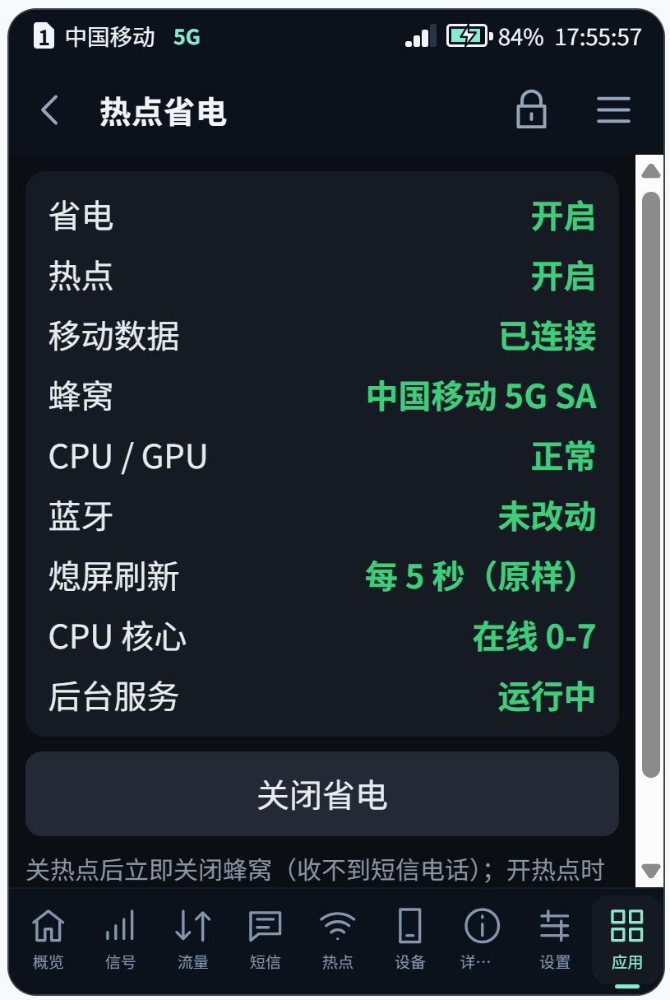
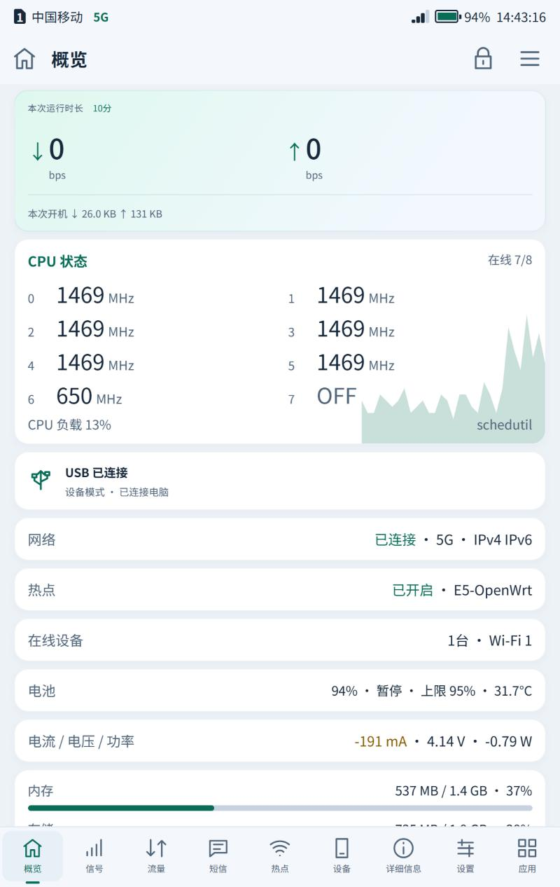
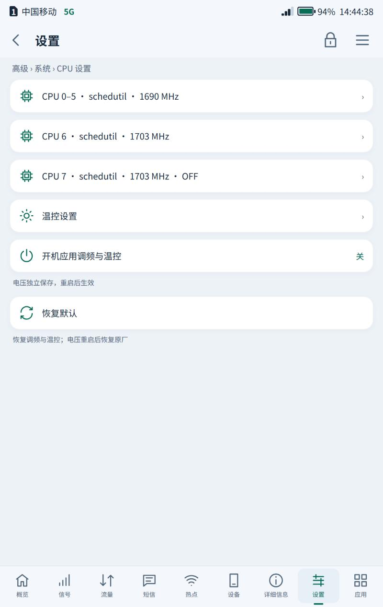
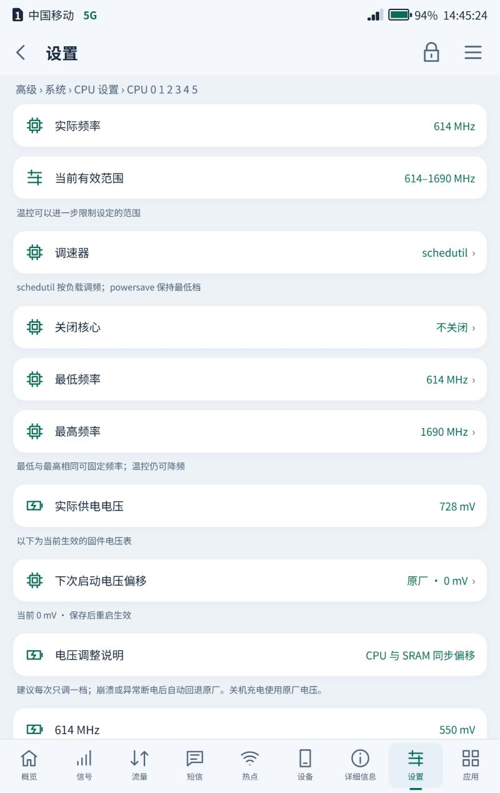
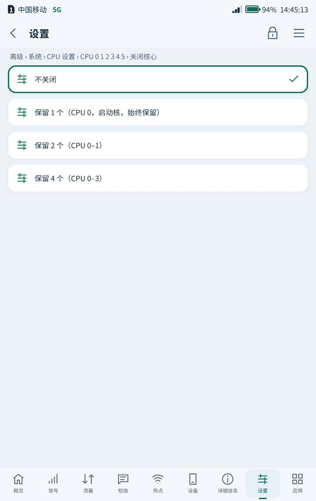
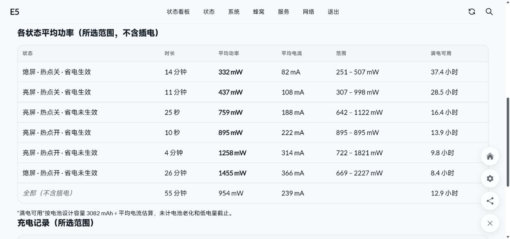

# 热点省电 · Hotspot Power Saver

关热点时关射频、降频、关核心、关蓝牙，熄屏后深度休眠，开热点恢复；CPU 设置可关闭核心（OFF）；USB 可关闭（仅充电）

*Radio, CPU and Bluetooth off while the hotspot is off, and deep sleep with the screen dark; OFF for CPU cores in CPU settings; USB can be turned off (charge only)*

容悦 E5（OpenWrt）信息屏应用。当前版本 **v2.8**，应用 ID `hotspotdata`。

## 截图

设备屏幕上的热点省电页面：省电开关、热点、移动数据、蜂窝、CPU / GPU、蓝牙、熄屏刷新、CPU 核心和后台服务的当前状态。

   

v2.7 起，从左到右：概览页运行时长下的 CPU 状态卡片（各核频率、CPU 7 已 OFF、负载走势）和带功率的“电流 / 电压 / 功率”；
CPU 设置列表（每行显示调速器、最高频率和关闭状态）；CPU 0–5 设置页，调速器下的“关闭核心”；“关闭核心”的选项。

用[功率监测](https://github.com/CharlesGool/e5-powermon)实测：熄屏、热点开、省电未生效时平均 1455 mW（满电约 8.4 小时）；熄屏、热点关、省电生效时平均 332 mW（满电约 37.4 小时）。

## 安装

1. 下载 [`releases/hotspotdata-v2.8.tar.gz`](releases/hotspotdata-v2.8.tar.gz)。
2. 在信息屏的「应用管理」中安装（LuCI：服务 → 信息屏应用 → 应用管理）。
3. 安装后文件位于设备上的 `/etc/e5-infoscreen/plugins/hotspotdata/`。

## 设置

加粗为默认值。

- 启用热点省电（Hotspot power saving）：默认开
- 关热点时（With the hotspot off）：**关闭蜂窝（最省电，收不到短信电话）**；只断数据（短信电话正常）
- 射频关闭时暂停 SIM 状态轮询（Pause SIM polling while radio is off）：默认开  
  更省电；期间状态栏不显示运营商
- 关热点时 CPU / GPU 锁最低频率（Lowest CPU / GPU clocks with the hotspot off）：默认开  
  开热点时恢复；期间屏幕操作会变慢
- 关热点时关闭 CPU 核心（CPU cores with the hotspot off）：**只留小核**；只留 2 个小核；全部保留  
  开热点时全部恢复；若关核心导致死机，下次开机自动改回全部保留
- 屏幕亮着时临时恢复全速（Full speed while the screen is lit）：默认开  
  亮屏 1 秒内放开核心和频率，熄屏 5 秒后恢复限制
- 熄屏时暂停屏幕电源监视（Pause the screen power watcher while dark）：默认开  
  熄屏 5 秒后暂停每秒 10 次的背光检查，亮屏后恢复
- 无设备连接时自动关热点（分钟）（Hotspot off when unused (min)）：0–120 min，默认 30  
  0 为不自动关；USB 连着电脑时不关
- 关热点时关闭蓝牙（Bluetooth off with the hotspot）：默认开  
  有蓝牙设备连着时不关；开热点时恢复
- 关热点后深度休眠（Deep sleep with the hotspot off）：默认开  
  熄屏后系统真正休眠，按键、充电器、基带唤醒；插着 USB 或充电时不休眠
- 熄屏后多久开始休眠（秒）：5–600，默认 30
- 蜂窝射频开着时也休眠：默认关  
  默认只在射频关闭后休眠；射频开着时基带每隔几秒唤醒一次，反复醒睡可能比不睡更费电
- 唤醒后保持清醒（秒）：2–60，默认 5  
  基带唤醒（短信、来电）时至少 15 秒
- 休眠时定时唤醒（分钟）：0–240，默认 0
- 射频关闭时熄屏刷新间隔（Dark-screen refresh with the radio off）：5 秒（原样）；30 秒；**1 分钟**；5 分钟
- 关热点后延迟断开（分钟）（Delay after hotspot off (min)）：0–30 min，默认 0

## CPU 设置中的关闭核心

系统的 CPU 设置（屏幕：设置 → 系统 → CPU 设置）里，每个频率域（E5：CPU 0–5、CPU 6、CPU 7）的
“调速器”下面多了一行 **关闭核心**，点进去选择：

- 大核（CPU 6、CPU 7，各 1 个核心）：不关闭；**OFF（全部关闭）**。
- 小核簇（CPU 0–5，6 个核心）：不关闭；**保留 1 个（CPU 0，启动核，始终保留）**、**保留 2 个（CPU 0–1）**、
  **保留 4 个（CPU 0–3）**，其余核心离线。CPU 0 是启动核，不会被关闭。
  想让两个大核跑、小核只留一个，就把 CPU 0–5 选成“保留 1 个”，在线的是 CPU 0、6、7。
- 选“不关闭”即全部重新开启。核心关着时也可以改调速器和频率，不会把核心打开，开启后按新设置运行。
- 整机至少保留 2 个核心在线：会少于 2 个的选项不显示，提交也会被拒绝（例如 CPU 6、7 都 OFF 后，
  CPU 0–5 只能保留 2 个或 4 个）；“关热点时关闭 CPU 核心”保留的核心若被关掉，也会补一个其他核心，凑够 2 个。
- CPU 设置列表的每行显示该域的调速器和最高频率，如“CPU 0–5 · schedutil · 1690 MHz”；关闭的域再标 “· OFF” 或 “· 保留 N 核”，页面显示离线核心；热点省电临时关掉的核心
  也会如实显示，不再是空白。
- 与系统调频一样只在本次开机有效；打开“开机应用调频与温控”时一并保存
  （`/etc/hotspotdata.cpu-off`），开机后由本应用的服务再次关闭。若关核心导致死机，下次开机不再关闭。
- 热点、亮屏恢复核心时不会打开关闭的核心；关热点期间改回“不关闭”，被“关热点时关闭 CPU 核心”管着的核心仍保持离线，开热点或亮屏时再打开。恢复默认会把 OFF 的核心全部打开。
- 与“关热点时 CPU / GPU 锁最低频率”配合：锁频期间开回的核心也锁在最低档，开热点或亮屏时恢复到原来的最高频率（锁频时离线、写不进去的原值先记在 `/var/run/hotspotdata.perf-pending`）；锁频期间在 CPU 设置里修改，调用 `cpu-control` 时临时换回真实频率，开机配置存的是真实值，改的最高频率在恢复时生效。
- 系统 CPU 后端（`cpu-control`，LuCI 与屏幕共用）把没有在线核心的域读成空，开机配置若在这时保存，
  下次开机会被拒绝（“CPU topology changed”）。所以屏幕 CPU 设置的每次修改都经由
  `cpu-off.sh`：先临时打开离线的核心，调用 `cpu-control`，再关回去。LuCI 的 CPU 设置页没有经过它，
  有核心关闭时请勿在 LuCI 里保存开机配置。

实现：本应用给 `/usr/share/e5-infoscreen/settings.uc` 打补丁（`cpu-patch.uc`，与 `app.js` 的补丁同一标记），
写入前先编译检查；镜像更新后一分钟内自动重打。卸载应用时打开 OFF 的核心并去掉补丁。

## 概览页的 CPU 状态卡片

概览页（运行时长卡片正下方）多了一张 **CPU 状态** 卡片：每个核心的当前频率（2 列，CPU 0–7），
关闭的核心显示 OFF（CPU 设置里关闭）或“离线”（关热点时被热点省电关闭）；右上角在线核心数，
底部整机 CPU 负载和调速器，右下角是最近约 80 秒的负载走势。只在概览页可见、屏幕亮着时每 2 秒
刷新（`GET /api/plugins/hotspotdata/cores`），熄屏或切到别的页面时不请求。

概览页的“电流 / 电压”一行也改为“电流 / 电压 / 功率”，在后面加上功率（电流 × 电压，如 `-350 mA · 4.12 V · -1.44 W`）。

实现：本应用给 `/usr/share/e5-infoscreen/www/index.html` 注入卡片脚本（`cores-card.html`，放在
`app.js` 之后，内容变化时屏幕重启一次）；卸载应用后卡片自动消失。

## USB 关闭（仅充电）

USB 设置（屏幕：设置 → 高级 → USB → USB 角色）多了一项 **关闭（仅充电）**：USB 接口只用来充电，
数据完全关闭——插电脑看不到设备、USB 网络和 SSH 断开，插 U 盘、网卡等 USB 设备也不会被识别，
E5 也不会通过 USB 口对外供电。选其他角色（自动识别、设备模式、主机 · OTG）即恢复。

- 用的是内核已有的两个开关：Type-C 口固定为受电方（`usb_role_policy` = `device`），
  USB 控制器的数据开关关闭（`/sys/class/usb_notify/usb_control/usb_data_enabled` = 0，原厂“禁用 USB 数据”）。
  充电走 VBUS 和充电芯片自己的检测，不受影响。
- 重启后保持关闭（`e5-plugin-hotspotdata.settings.usb_off`，系统 USB 角色设置之后由本应用的服务再次关闭），
  刷机升级保留设置时也保留。
- 关闭时屏幕的“当前角色”显示“关闭（仅充电）”；USB 网络断开后仍可通过热点（Wi-Fi）访问 LuCI / SSH。
- 卸载应用会重新打开 USB 并去掉补丁。

实现：本应用给 `/usr/share/e5-infoscreen/settings.uc` 打第二个补丁（`usb-patch.uc`，独立标记，
放在“关于”之前），切换经由 `usb-off.sh`；信息屏或镜像更新后一分钟内自动重打。

## 深度休眠

OpenWrt 从不让内核休眠：熄屏只是背光为 0，SoC 一直醒着。内核和固件其实支持
（`/sys/power/mem_sleep` 有 `deep`），`sleep.sh`（同一服务的 `sleep` 实例）在下面几条
都满足时让系统挂起到内存，被无关事件唤醒后很快再睡回去：

- 熄屏达到设定时间；
- 热点关闭：Wi-Fi 驱动休眠时会停掉 AP，hostapd 不知道，热点会坏；
- 没插 USB、没充电：USB 驱动有 VBUS 时拒绝休眠；
- 蜂窝射频已关闭（或打开了“射频开着时也休眠”）；
- 没有声音在播放或录音，没有 `/sys/power/wake_lock` 唤醒锁。

连续 3 次睡不到 10 秒会暂缓休眠（60 秒起，加倍，最多 10 分钟）。

实测（关热点、射频关、熄屏、拔线）：152.9 秒里睡了 148.6 秒（97%）；电源键唤醒并点亮屏幕。
射频和数据开着时只睡 17.6%，平均 147 mA，比不睡（74 mA）更费电，所以默认只在射频关闭后休眠。

主线内核的 PMIC 看门狗驱动（`ump9620-pmic-wdt`）没有挂起处理，休眠时照样计时，procd 被冻结
无法喂狗，睡满 30 秒就会复位并回退进 Android。所以每次休眠前让 procd 用 magic close 关闭看门狗，
醒来立刻重新打开。

休眠会让 CLOCK_MONOTONIC 停走、/proc/uptime 照走：系统的 t551m-sim-status 用前者给 SIM 状态
打时间戳，状态栏和本应用用后者判断新旧，休眠过一次后信号就一直显示“状态未知”、蜂窝“读取中”。
本应用会把 t551m-sim-status 和 t551m-registration 改成 CLOCK_BOOTTIME（镜像更新后自动重做）。

已知限制：侧键长按（sidekey）在休眠中可能被识别成单击（唤醒约需 1 秒）；每次唤醒内核会把
显示面板重新上电一次。日志：`logread -e hotspotdata | grep sleep:`。

## 源码

`hotspotdata/` 是当前版本安装包解压后的内容：

- [`backend.uc`](hotspotdata/backend.uc)
- [`cpu-off.sh`](hotspotdata/cpu-off.sh)
- [`cpu-patch.uc`](hotspotdata/cpu-patch.uc)
- [`cores-card.html`](hotspotdata/cores-card.html)
- [`hotspot-data.init`](hotspotdata/hotspot-data.init)
- [`index.html`](hotspotdata/index.html)
- [`manifest.json`](hotspotdata/manifest.json)
- [`poll-patch.js`](hotspotdata/poll-patch.js)
- [`service.sh`](hotspotdata/service.sh)
- [`sleep.sh`](hotspotdata/sleep.sh)
- [`usb-off.sh`](hotspotdata/usb-off.sh)
- [`usb-patch.uc`](hotspotdata/usb-patch.uc)

## 版本

- [v2.8](releases/hotspotdata-v2.8.tar.gz)（当前）：USB 设置的“USB 角色”增加“关闭（仅充电）”，物理上禁用 USB 数据，重启后保持
- [v2.7](releases/hotspotdata-v2.7.tar.gz)：系统 CPU 设置的调速器下增加“关闭核心”（大核 OFF，小核簇保留 1/2/4 个）；概览页增加 CPU 状态卡片、电流电压后显示功率；修复核心离线时 CPU 设置页显示空白、保存开机配置会在下次开机被拒绝
- [v2.6](releases/hotspotdata-v2.6.tar.gz)：深度休眠的唤醒原因也看中断计数，按键唤醒不再显示“未知唤醒”
- [v2.5](releases/hotspotdata-v2.5.tar.gz)：关热点后深度休眠；修复休眠后信号显示“状态未知”
- [v2.3](releases/hotspotdata-v2.3.tar.gz)
- [v2.2](releases/hotspotdata-v2.2.tar.gz)
- [v2.1](releases/hotspotdata-v2.1.tar.gz)
- [v2.0](releases/hotspotdata-v2.0.tar.gz)
- [v1.9](releases/hotspotdata-v1.9.tar.gz)
- [v1.8](releases/hotspotdata-v1.8.tar.gz)
- [v1.7](releases/hotspotdata-v1.7.tar.gz)
- [v1.5](releases/hotspotdata-v1.5.tar.gz)
- [v1.4](releases/hotspotdata-v1.4.tar.gz)
- [v1.3](releases/hotspotdata-v1.3.tar.gz)
- [v1.2](releases/hotspotdata-v1.2.tar.gz)
- [v1.1](releases/hotspotdata-v1.1.tar.gz)
- [v1.0](releases/hotspotdata-v1.0.tar.gz)
